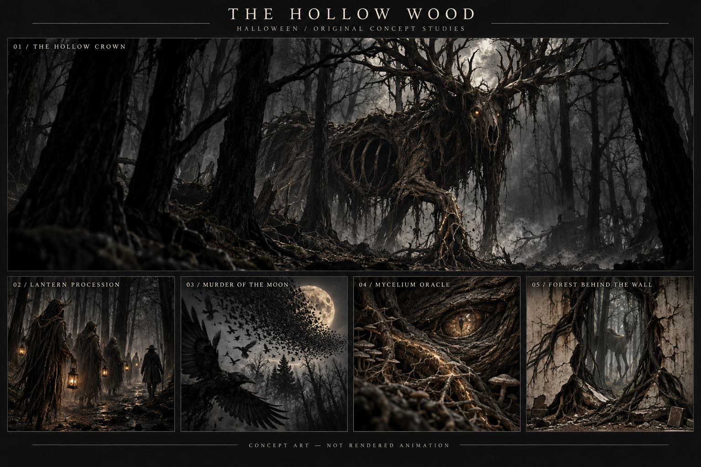

# The Hollow Wood — research synthesis, draft for independent challenge

**Brief:** Dark enchanted forest and spectral creatures, chosen by Shane. Twenty proposals are in [the candidate matrix](00-brief-and-candidates.md). This document develops five provisional treatments; independent selection and critics can change them. These are original designs, not shipped effects or completed animations.

The board is an art-direction study generated with the built-in image tool. It establishes a possible visual vocabulary, not frame continuity, rig quality, projection contrast or attainable frame rate. It is visibly more detailed and darker than a projection-ready simplification should be. The creature, anatomical landmarks and main transformation must survive without those microtextures.

## Research conclusions

1. **Make the forest an actor.** URBANSCREEN describes FinsterWald as a constantly changing living being, while Moment Factory describes Forest of Shadows as projection and lighting that distort familiar natural surroundings. Our inference: animate a relationship between environment and entity, rather than placing interchangeable symbols over a black field. [FinsterWald](https://www.urbanscreen.com/finsterwald/), [Forest of Shadows](https://momentfactory.com/products/forest-of-shadows).
2. **Give visibility a story purpose.** Cinematographer Jarin Blaschke's accounts describe shaped light and carefully controlled night-scene tones. Our transfer is a broad backlight revealing a threatening silhouette, with selected local highlights, not uniformly dark footage or a maximum-brightness outline. A camera image and a projected wall have different contrast limits. [ASC production account](https://theasc.com/article/conjuring-a-coven-for-the-witch/), [Focus Features interview](https://www.focusfeatures.com/article/nosferatu_interview_jarin-blaschke).
3. **Keep identity through material change.** Universal Everything describes Transfiguration maintaining its walking action as materials transform. Our inference is to retain the stag's trunk/spine and branch/antler landmarks throughout the reveal. A crossfade between unrelated stills is insufficient. [Artist project](https://www.universaleverything.com/art/transfiguration-2024).
4. **Author flow, not particle count.** Curl-noise gives a useful technical basis for coherent flow around boundaries. It is neither an aesthetic guarantee nor proof of a cheap implementation in this app. The fog must react to the creature's movement; the flock must preserve a readable group arc. [Bridson et al., original paper](https://www.cs.ubc.ca/~rbridson/docs/bridson-siggraph2007-curlnoise.pdf).
5. **Treat the surface as part of the fiction.** 555 KUBIK derives its transformations from its architecture; Skeleton Dance makes paving appear to open. Our wall/forest idea transfers this principle to one mapped panel, with limits for arbitrary mesh geometry and off-axis viewing. [URBANSCREEN](https://www.urbanscreen.com/555-kubik/), [Skullmapping](https://skullmapping.com/project/skeleton-dance/).

## Five provisional treatments

All timings below are authored proposals at a nominal 24 seconds, not observations of reference footage or an empirically optimal loop length. Share a world and palette, but give each loop a different dramatic mechanism. Do not combine all five into one busy simultaneous show.

### 1. The Hollow Crown — recognition and transformation

**Image and action:** a vast blackthorn trunk slowly resolves into a hollow antlered revenant. Three depth planes establish a clearing. As one root loosens into a foreleg, the viewer realizes the tree has been looking back. This is a severe skeletal woodland entity, not a luminous healthy deer.

**0–6s:** fog travels behind the trunk; surrounding boughs lean inward. **6–12s:** a sap-light wave follows the spine, shoulder and three main antler forks; the silhouette becomes unmistakably a stag. **12–17s:** one slow head turn, held long enough to register, while a nearby shadow begins a fraction early. **17–21s:** the foreleg settles; broad branches sweep across the head. **21–24s:** the fully concealed head resets; the torso becomes trunk again and the fog restores its initial state. Use the early-shadow contradiction once. Do not also add an out-of-sync reflection and a jump scare.

**Merge discipline:** take structural framing from candidate06 and one restrained behavioral contradiction from16. Drop their full cathedral and second deer/reflection sequences. Keep one protagonist and one reveal.

**First proof:** fixed camera, one hero composite; no full locomotion, no open-mouth attack. Needed original assets: a tree/stag correspondence rig or deliberately authored 2.5D deformation, three forest depth layers, shadow pass, broad fog pass. Main risk: rubber morph or a stationary illustration with glow. Reject if the head turn cannot hold anatomical coherence.

### 2. The Lantern Procession — collective behavior and absence

**Image and action:** tall faceless travelers wind behind trunks. Their feet, variable pacing and light on nearby bark give them weight. One lantern continues after its carrier has vanished.

**0–6s:** three separated low lights approach along a curved path. **6–11s:** partial bodies cross alternating occluders at two depths. **11–15s:** the travelers stop in a traveling sequence, then all turn toward the same unseen point. **15–19s:** carriers vanish behind trunks while one large shadow keeps moving the wrong way. **19–24s:** the last lantern is swallowed by a broad trunk and a distant light restores the opening. Hidden return paths reset bodies offscreen or behind masks.

**Merge discipline:** take the wrong-shadow moment from07. Candidate14's bell is a possible timing metaphor, not an audio dependency or another visible subplot. Main risk: evenly bobbing duplicate ghost sprites. Reject without grounded paths, body performance and depth occlusion.

### 3. Murder of the Moon — coherent flock and lost light

**Image and action:** a broad crow flight climbs through bare trees and eclipses a tarnished moon. The flock briefly resolves into one impossible wing before breaking into leaves.

**0–6s:** the first distinct crow establishes anatomy and flight direction; the moon lights the upper clearing. **6–12s:** one coherent flock arc gathers, with large foreground wings and a simpler distant mass. **12–16s:** a single wave of wing alignment veils the moon; one enormous silhouette holds. **16–20s:** the flock breaks into broad leaf shapes that follow the same flow. **20–24s:** leaves pass behind the canopy; moon and distant flock return to initial states. Reset hidden individual birds only in the occluded band.

**Merge discipline:** compare moth candidate09 as an alternative wing design; do not include both animals. Main risk: swarming noise or a generic vortex. Reject if the moon, flock arc and one readable crow cannot be identified at thumbnail size. This is a low-foreground-light composition, not a blanket white flash.

### 4. The Mycelium Oracle — propagation and material presence

**Image and action:** roots and fungal channels carry a slow wave through an ancient woodland organism. The apparent bark grain becomes a single eye; the environment seems to sense the observer.

**0–6s:** irregular root arcs remain still while one low light travels toward their junction. **6–12s:** a causal wave moves through only three large branch paths; nearby fibers pull inward. **12–16s:** heavy overlapping wood plates separate once to expose a wet reflective cavity. **16–20s:** the cavity turns slightly as if attending to the viewer, then closes while the network's tension releases. **20–24s:** light retreats into one seedlike knot; channels return to starting state. Following the creature-design challenge, prefer this material opening over a literal reptilian pupil or iris; fungal sentience is authored fantasy, not a biological research claim.

**Merge discipline:** use15's unfolding principle only as a material deformation; no second luminous flower. Main risk: neon circuit board or a face painted on wood. Reject symmetric smiling anatomy, equal-brightness filaments or an eye with no physical lid deformation. This macro encounter offers different scale from the wide forest scenes.

### 5. The Forest Behind the Wall — surface violation and concealment

**Image and action:** root seams spread along a mapped panel and appear to peel the surface into a deep woodland opening. Something tall walks behind the trees; the forest closes before it is fully seen.

**0–6s:** a few roots follow the panel's visible boundary, then gently pull its interior inward. **6–12s:** a broad seam separates with a thick apparent edge, revealing staggered woodland depth. **12–17s:** a large partial shoulder and antler-like branch move behind two trunks in the opening; no second full stag portrait. **17–21s:** roots close the seam as the unseen presence presses toward it. **21–24s:** bark/plaster landmarks restore precisely to their initial state under the closing edge.

**Merge discipline:**13 can inform the restoration of leaves, but reversed leaf fall is not another act. Pond08 stays an alternate depth study; adding water and mirrored creatures here would dilute the surface illusion. Main risk: an ordinary framed video portal. Reject if the opening edge does not appear attached to the mapped surface. Needs an authored neutral-panel variant; do not assume automatic wall scanning or arbitrary façade geometry.

## Production route and proof ladder

Recommended route to test: original offline-authored hero scene played through existing media support. Native shaders remain appropriate for broad fog or adjustable supporting motion once their contribution and performance are demonstrated. A new realtime volumetric engine is unnecessary for the first comparison. Choosing video trades in-app procedural controls for richer authored animation, media storage and decode requirements; this is a real tradeoff, not a free upgrade.

1. **Core action animatic:** one complete low-detail Hollow Crown loop. Show the branch/antler correspondence, head turn, shadow relationship and hidden reset. Reject the scene before detailed production if the core reads as a static picture with effects.
2. **Look and readability proof:** establish three readable masses, then add only texture that survives quarter-size viewing and a lifted-black stress preview. Those are screening proxies, not projector simulation or calibrated thresholds.
3. **Actual mapper proof:** play the resulting original media in a disposable `.pmap`, observe at least three complete playback loops, editor and output together, actual controls/save/reopen, and a representative deformed panel. Same-file surfaces share a source; cross-file synchronization is unproven. Audio is muted by default but the existing Mute audio checkbox can enable it; no new audio-reactive feature is assumed.
4. **Performance and data proof:** measure sustained decoded delivery rather than compositor repaint rate alone. Package the media and scene references together; preserve originals and earlier runtime. No added assets live only in a temporary generation folder.
5. **Projector acceptance:** observe at intended surface size, wall material, ambient light and viewing distance. Score observed creature recognition, depth and motion as separate judgments. Computer capture cannot establish this.

No implementation or update has started in this research pass. The current report must withstand source, diversity, projection and final-critic review before its shortlist is treated as final. A 9.5 finished-animation score has **not** been established by this document or by the concept art.
